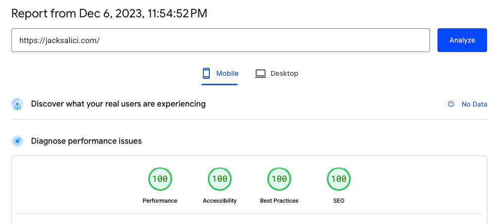

# Just my website. 🥸💅

Howdy! If you are reading this, you probably already know that the website simultaneously represents 📺:

- a portfolio for my personal and academic projects 🖼️,
- a kind of online resume 🪪,
- and a placeholder space for my nickname domain ⚓️.

## Architecture 🏗️

Currently, the website is powered by Astro.

**Posts are stored in the `src/content` folder.**

## Commands 🧞

All commands are run from the root of the project, from a terminal:

| Command                   | Action                                           |
| :------------------------ | :----------------------------------------------- |
| `bun install`             | Installs dependencies                            |
| `bun run dev`             | Starts local dev server at `localhost:4321`      |
| `bun run build`           | Builds the production site to `./dist/`          |
| `bun run preview`         | Previews the build locally, before deploying     |
| `bun run astro ...`       | Runs CLI commands like `astro add`, `astro check` |
| `bun run astro -- --help` | Shows help for the Astro CLI                     |

Once the edits have been made, *just push the commits*: Vercel will build the website and host it.

## Changelog 🕰️

I like to change its style often. Every version since 2021 lives in [`src/data/changelog.json`](src/data/changelog.json) and is shown as a timeline, with screenshots, at [jacksalici.com/notes/website](https://jacksalici.com/notes/website). New version? Add an entry on top of that file and drop its screenshot in `src/assets/uploads/website/versions/`.

