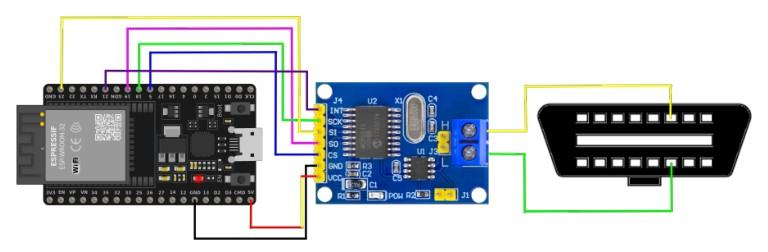

**Abstract:** The complete workflow of the RI-PIENO framework is presented, a system for refueling itinerary optimization that extends the original PIENO design. While prior work introduced the conceptual modules of RI-PIENO, their operational pipeline was not described in detail. This study makes the workflow explicit, covering the end-to-end process from CAN Bus data acquisition and stop detection to the construction of daily trip graphs, refueling optimization, and mileage prediction. By clarifying the sequence of operations, the contribution provides a reproducible and extensible foundation for future research and development.

---

## A closer look

Where and when to refuel is a decision drivers take over and over with little information, although fuel prices, detours and personal habits all bear on it. [RI-PIENO](/papers/ripieno), our framework for refueling itinerary optimization, was first presented through its modules and its results; how data actually travels from the car to the recommendation was left implicit. This short paper writes that pipeline down, step by step, so that it can be reproduced and extended.

*Figure 1 — The CAN Access Module: an ESP32 microcontroller reads the vehicle CAN bus through the OBD-II port.*

Everything starts at the CAN Access Module, an ESP32 attached to the vehicle CAN bus. It isolates the fuel-level signal, whose message identifier is inferred by correlating the transmitted values with the behaviour of the fuel gauge, and it detects stops: the bus goes silent when the car is turned off, so the absence of messages marks a stop. Each stop is stored in the mobile app as a candidate point of interest, with its coordinates (nearby stops are clustered), its visit frequency and the days on which it occurs; a candidate that recurs at least twice a week is promoted to a point of interest, and the points of a day, ordered in time, form the Daily Trip Graph. The app then combines the graph and the weekly mileage forecast with the Prophet price prediction and the government list of fuel stations, and the Fuel Stop Optimization module chooses the station by weighing cost against time with two tunable constants, $K_1$ and $K_2$.

On 15 paths recorded by 3 users, the complete workflow yields refueling stops that cost €43.01 ± 2.13 and take 4.98 ± 0.80 minutes, against €43.24 and 7.10 minutes for the original PIENO and €44.53 and 6.61 minutes for the baseline that stops at the closest station.
