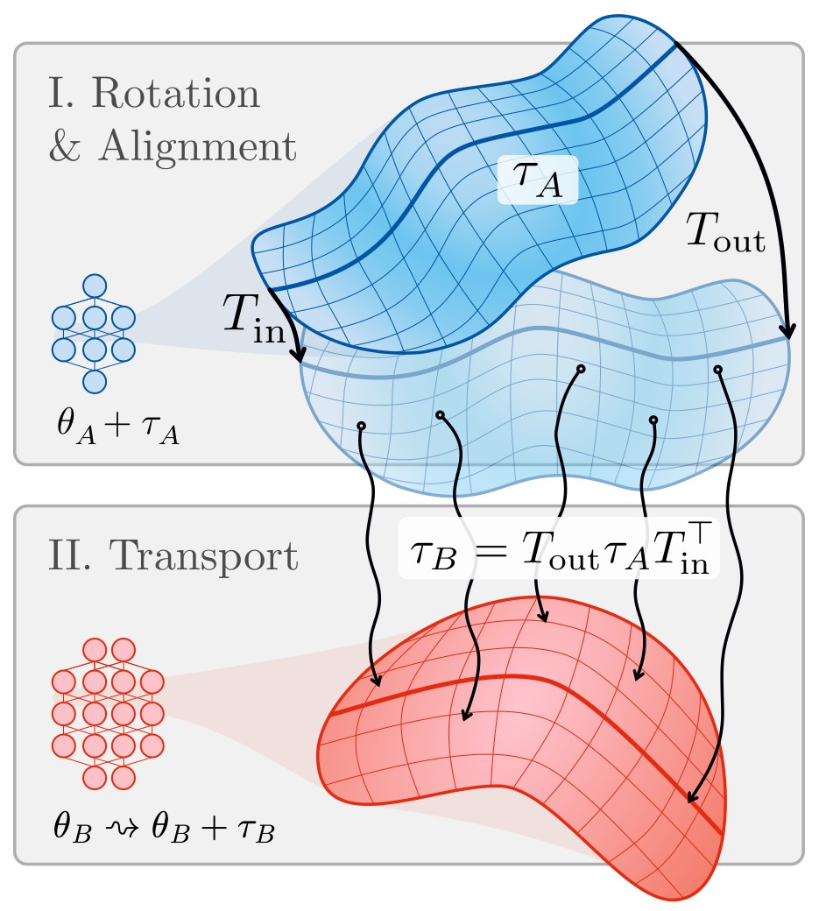

**Abstract:** Adapting large pre-trained models to downstream tasks often produces task-specific parameter updates that are expensive to relearn for every model variant. While recent work has shown that such updates can be transferred between models with identical architectures, transferring them across models of different widths remains largely unexplored. In this work, we introduce **Theseus**, a training-free method for transporting task-specific updates across heterogeneous models. Rather than matching parameters directly, we characterize a task update by the functional effect it induces on intermediate representations. We formalize task-vector transport as a functional matching problem on observed activations and show that, after aligning representation spaces via orthogonal Procrustes analysis, it admits a stable closed-form solution that preserves the geometry of the update. We evaluate Theseus on vision and language models across different widths, showing consistent improvements over strong baselines without additional training or backpropagation. Our results show that task updates can be meaningfully transferred across architectures when task identity is defined functionally rather than parametrically.

---

## A closer look

Models come in families of several sizes, and a task learned by one member is not available to the others: fine-tuning has to be repeated, or distilled, for each of them. The methods that move a fine-tuning update, or *task vector*, between models assume identical architectures. When widths differ the weight matrices do not even have the same shape, and padding or projecting them does not preserve what the update does.

*Figure 1 — Transport by orthogonal alignment. Procrustes rotations find the structure shared by the two representation spaces, so that a task update can be moved between models of different dimensions without training.*

Theseus defines a task update by its effect on activations, not by its parameters. For each linear layer we collect, on a few calibration batches, the input and output activations $H_\text{in}$ and $H_\text{out}$ of the source model $A$ and of the target model $B$, and look for the target update $\tau_B$ that reproduces the bilinear form induced by the source update $\tau_A$:

$$
\min_{\tau_B} \left\| H_{\text{in},A} \, \tau_A^\top H_{\text{out},A}^\top - H_{\text{in},B} \, \tau_B^\top H_{\text{out},B}^\top \right\|_F^2
$$

Across mismatched spaces this problem has many solutions, some of which amplify poorly conditioned directions. We remove the ambiguity by aligning the input and the output spaces of the two models with two orthogonal Procrustes problems, solved in closed form by the SVD of the cross-covariances, $H_A^\top H_B = U \Sigma V^\top$ giving $T = U V^\top$. The resulting maps $T_\text{in}$ and $T_\text{out}$ yield the transport rule

$$
\tau_B = T_\text{out} \, \tau_A \, T_\text{in}^\top,
$$

which preserves the Frobenius norm of the update, $\|\tau_B\|_F = \|\tau_A\|_F$, and needs forward passes only: no training and no backpropagation.

Moving task vectors from a CLIP ViT-B/16 to the wider ViT-B/16+, pre-trained on a different dataset, raises the average accuracy of the target over eight vision tasks from 58.76% (zero-shot) to 64.59% with a single calibration batch of 32 images and to 69.48% with fifty; zero-padding the update gives 58.50%, and solving the matching problem by pseudo-inverse with one batch drops to 42.38%. From T5-3B to T5-Large, the transported encoder update lifts linear-probing accuracy on five language-inference tasks from 57.87% to 79.91%. A target fine-tuned on the task still does much better (90.39% on the vision benchmark): Theseus recovers part of the gain, for the price of a few forward passes. The name is the ship of Theseus: if every parameter changes, the task stays the same as long as its function does.
