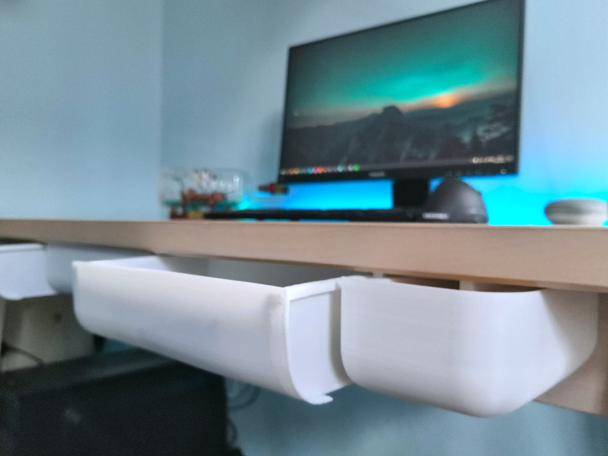

Flat-pack desks are cheap and sturdy, but many of them are just a top on four legs, with nowhere to put the small things that end up scattered on the surface. 3D printing makes it practical to design storage around the exact geometry of one piece of furniture instead of adapting a generic organiser to it.

The desk where I spend several hours a day is the IKEA Norråker table, and it has no drawers. There are, however, about 12 cm between the apron (the wooden panel that connects the legs and the top) and the edge of the surface, so I designed several drawers that fit in that space, under the overhang of the top.

The 3D-printable models and a more detailed description are [on Thingiverse](https://www.thingiverse.com/thing:4788776 "My Thingiverse page").
