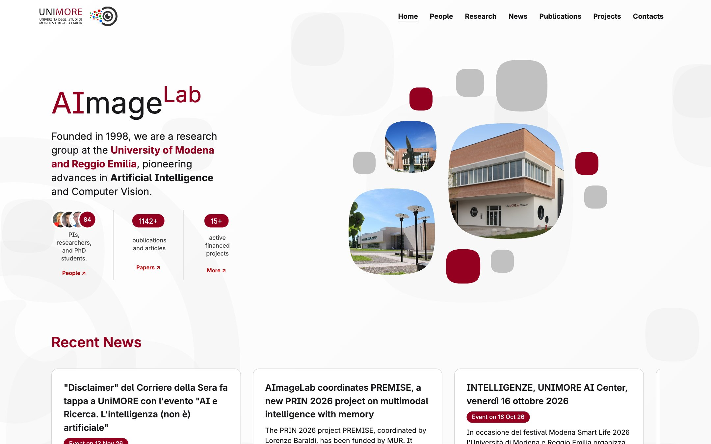

The website of a research group is mostly a catalogue of people, publications and projects, and it goes stale quickly when every paper and every new member has to be entered by hand. Over the last months, some colleagues at AImageLab, the research group of the University of Modena and Reggio Emilia where I work, and I developed a new website for the lab that takes this information from the systems where it already lives.

The site is a Django application served by Gunicorn behind an Apache reverse proxy, which terminates HTTPS with Let's Encrypt certificates; data is stored in MySQL 8.0 and the pages are styled with Tailwind CSS. Background work is delegated to Celery: two worker containers consume tasks from a Redis broker, and a Celery beat container schedules the periodic ones, so that operations such as sending emails or importing data do not block a web request. Everything is containerised with Docker Compose, with separate production and development stacks that run side by side on our own server.

The publications section is filled automatically: once a day a scheduled task queries the REST API of IRIS, the research catalogue of the university, for every staff member, and creates or updates the corresponding records. The list of members is likewise synchronised from the university directory rather than edited by hand, and a news section collects updates and events about our research activities.
