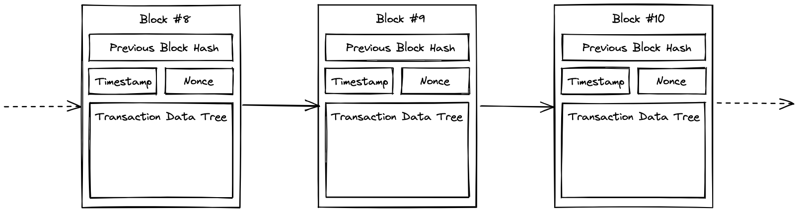

A blockchain is a distributed digital ledger in which each block stores the hash of the previous one, so that a past record cannot be altered without invalidating everything that follows, and no single party has to be trusted to keep the history intact. Immutability and decentralisation have led to proposals in many fields, from financial applications to supply chains, but serious questions remain open about the actual utility of the technology and about its consequences, such as the environmental footprint and the privacy issues.

I wrote my B.Sc. dissertation on this topic at X DataNet Srl, a software house based in Mirandola (Modena) that at the time had been producing software for twenty-seven years, mainly for the digitalisation of governance processes such as the voting procedures of boards of directors and shareholders' meetings. The company wanted to know whether blockchain could increase the security and quality of its products. During the time I spent there, my task was to research the technology, analyse its actual pros and cons, build some proofs of concept and study possible integrations with their software.

The study identifies two candidates, the e-voting and the notary software: smart contracts, immutable procedures executed on the blockchain, would add a security level to an already established architecture, with the blockchain playing the role of a trusted third party for electronic ballots and for the digital notarisation of documents. The prototype of the digital notary service uploads the digest of a document to the blockchain, and it could also integrate the e-voting protocol analysed in the thesis, a blind-signature scheme over elliptic-curve cryptography (ECC). To get the entire paper, please contact me.
