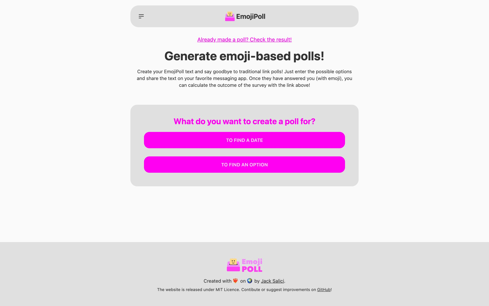

Choosing a date or a place in a group chat usually ends in one of two ways: a link to an external survey that half of the group never opens, or a thread of replies that somebody has to count by hand. In August 2022 WhatsApp had no native polls, and I wanted a vote that stayed inside the conversation.

EmojiPoll is a single-page Vue application with no backend. You enter the options, either free text or dates picked from a calendar with optional time slots, and the app assigns a random emoji to each one and generates a formatted message to copy or share on WhatsApp. People vote by replying with the emoji of their choice. To close the poll you paste the replies into a second page, where a regular expression extracts the emoji and tallies them, sorted by number of votes. Nothing is stored or sent anywhere: the poll lives entirely in the chat. The interface is translated into five languages (English, Italian, German, Spanish, French) and the code is [open source](https://github.com/jacksalici/emojipoll) under the MIT licence.

_WhatsApp introduced its own polls about one month after I published the app, which removed the reason for it to exist, and I stopped working on it. Being a static site, [emojipoll.jacksalici.com](https://emojipoll.jacksalici.com) is still online._
