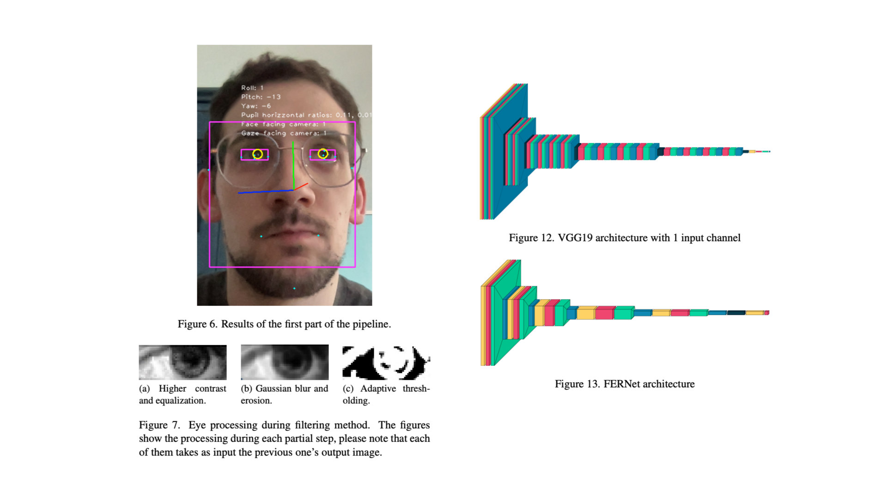

A machine that interacts with people needs to know at least three things about each face it sees: whether the person is looking at it, whether it should care about that person, and how the person feels. EmotiVision is the project that Michele Giarletta, Vincenzo Lapadula and I developed in 2023 for the Computer Vision and Cognitive Systems course at the University of Modena and Reggio Emilia, which asked for a pipeline combining classical image processing and deep learning. Ours has three stages (gaze analysis, face retrieval, emotion classification) and runs on a small demo robot.

The gaze stage is entirely classical. We detect faces (on the 35,887 single-face images of FER2013, dlib's HOG detector found exactly one face in 70% of them, OpenCV's Haar cascade in 57%), extract 68 landmarks with dlib, and solve the Perspective-n-Point problem with a calibrated camera to obtain pitch, yaw and roll; a face is considered to be facing the camera when the angles are below 20°. The pupil is then located inside the eye crop. We compared the means-of-gradients method of Timm and Barth with a filtering method of our own (contrast, blur, erosion, adaptive threshold, largest blob) on the roughly 1,500 hand-labelled images of the BioID dataset: the mean Hausdorff distance from the labels was 3.00 against 3.20, but our method took 0.028 s per image instead of 0.112 s, so the pipeline uses it. The retrieval stage aligns faces with MTCNN, embeds them with an InceptionResnet pre-trained on VGGFace2, and compares them by cosine distance with the embeddings of enrolled people, whom the robot should ignore. With one enrolled person and a threshold of 0.18, on a test set of about 400 positives mixed with the 13,233 images of LFW as negatives, the selected configuration reached 100% precision and recall. For the emotion stage we trained a VGG19 on CK+ (98.47% test accuracy) and distilled it into FERNet, a network of our design with 3.9 million parameters instead of 20.0 million, which classifies seven emotions: on the CK+ test set it reached 99.89% accuracy and an $F_1$ score of 99.42% (the abstract of the report summarises the results as an $F_1$ of 97%).

These numbers do not transfer to the real world. On a validation set of 65 photos that we took ourselves, both networks failed to predict several expressions, doing well only on overt ones such as surprise and happiness; the report attributes this to the subjectivity of facial expressions and to the gap between those in the dataset and those captured in the wild. The demo robot is an Arduino with a webcam and a stepper motor in a 3D-printed enclosure: it receives the rotation angle over the serial port and turns by 5° per frame until the widest detected face is within 150 px of the image centre, following the person until they look away. Code, [final report](https://github.com/SLG-Vision/EmotiVision/blob/main/emotivision_final_report.pdf) and a [demo video](https://www.youtube.com/watch?v=4cJKgOWtedk) are public.
