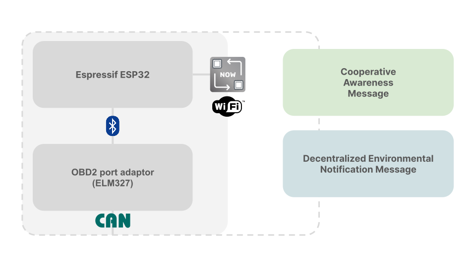

Cars that tell each other where they are and what just happened to them can brake before the driver sees the hazard, which is why both the US and the EU have worked on standards for vehicle-to-vehicle (V2V) and vehicle-to-everything (V2X) communication. In Europe, ETSI ITS-G5 defines two basic messages: the Cooperative Awareness Message (CAM), sent periodically with the state of the vehicle, and the Decentralized Environmental Notification Message (DENM), sent only when an event such as an accident occurs.

ESP-VANET, my final project for the Automotive Connectivity course of the master's degree, reproduces a simplified version of both messages with hardware anyone can buy: an ESP32 microcontroller and an ELM327 Bluetooth adapter plugged into the OBD-II port that every car already has. The nodes talk over ESP-NOW, Espressif's connectionless protocol (payload up to 250 bytes, 1 Mbps), using the broadcast address, and the speed is read from the car through the [ELMduino](https://github.com/PowerBroker2/ELMduino) library. CAMs are sent at a constant interval when the speed has changed, a reduction of the ETSI trigger rules, which also consider heading and travelled distance; a DENM is sent when the deceleration exceeds a threshold, as in a crash. Since a vehicular network has no infrastructure, every received packet can be rebroadcast, at most once, to reach vehicles further away. To avoid flooding the channel I applied the RSS-based broadcast suppression used with IEEE 802.11p: the weaker the received signal, hence the farther the sender, the more likely the retransmission,

$$
p = \frac{\text{RSS}_\text{max} - \text{RSSI}}{\text{RSS}_\text{max} - \text{RSS}_\text{min}}
$$

with $p = 0$ above $\text{RSS}_\text{max}$ and $p = 1$ below $\text{RSS}_\text{min}$. The RSSI of each packet is obtained by receiving in promiscuous mode.

The messages are mock ones: a single 14-byte structure carries the type, the address of the original sender, the speed, a severity from 0 to 5 for DENMs and a flag marking rebroadcast packets, without the ASN.1 encoding of the standard; the coordinates field exists but is not filled. Only standard OBD-II codes are used, so that the firmware works on a car of any manufacturer, and this is why deceleration is the only DENM trigger: steering angle or airbag state would require manufacturer-specific reverse engineering. The firmware is a PlatformIO project, documented in the repository.
