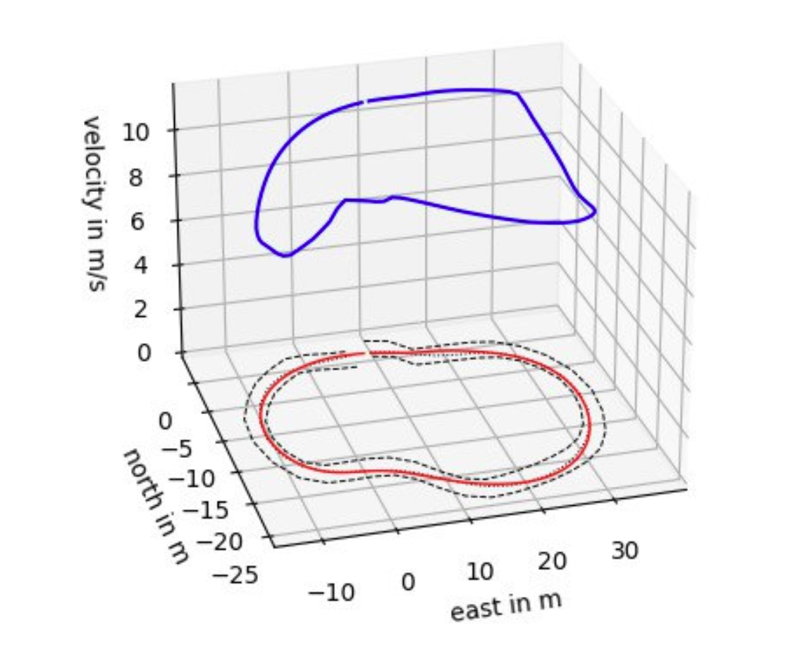

A driverless race car does not know the circuit in advance: during the first lap it discovers the track cone by cone and can only plan locally, while from the second lap on the whole circuit is known and the trajectory can be optimised globally. In the academic year 2023–24 I was a member of MMR Driverless, the autonomous division of the Formula Student team of the University of Modena and Reggio Emilia, where Cristiano Parenti and I worked on the module that does this, the global planner.

The planner is a ROS 2 (Foxy) node written in Python. At the end of the first lap the local planner publishes the centerline, as points $(x_i, y_i)$ with the distances to the right and left boundaries. We look for the raceline as a displacement $\alpha_i$ of each point along the normal to the centerline, and choose the displacements that minimise the squared curvature summed over the track, since a path with less curvature allows higher cornering speeds. With cubic splines this becomes a quadratic program,

$$
\min_{\alpha} \; \alpha^\top H \alpha + f^\top \alpha
$$

subject to the car staying inside the track and to its curvature limit. The formulation is the one of Heilmeier et al. (*Vehicle System Dynamics*, 2019) and the optimisation code comes from the [open-source repository](https://github.com/TUMFTM/global_racetrajectory_optimization) of TUM. Because the problem is linearised around the reference line, it is solved iteratively, smoothing and resampling the line with splines at every iteration, until the curvature error falls below a tolerance. The speed profile is then computed from the ggV diagram of the car, the maximum longitudinal and lateral accelerations available at each speed: first the cornering limit at every point, then a forward pass that bounds the speed by the available acceleration, $v(s + \delta s)^2 = v(s)^2 + 2\, a_{x,\max}\, \delta s$, and a backward pass that does the same for braking, keeping the minimum of the three.

The node publishes the result on a custom ROS topic as an array of points with position, target speed and target acceleration; internally each point also carries the curvilinear distance, heading and curvature. Vehicle and solver parameters are set through the ROS configuration, a legacy input keeps compatibility with the 2022–23 local planner, and the optimisation can be run offline on a CSV centerline, without ROS. The repository contains the code and our documentation (in Italian) at version 1.2.1, June 2024.
