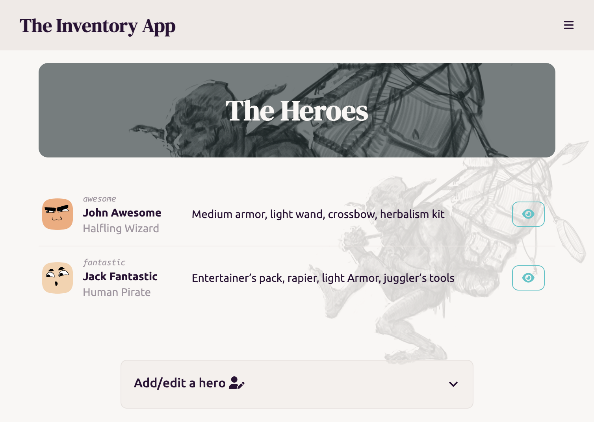

In a tabletop role-playing game every character carries equipment, coins and consumables that change at each session, and the paper sheet where they are written is never the one the rest of the party is looking at. The Inventory App is a free and open-source web app to keep the inventory of a whole party in one shared place.

The frontend is written in Vue, and the data lived in Deta Collections, a hosted NoSQL store, in two tables created on first use: `Heroes` (`nickname` as key, `name`, `details`, `equipment`, `slots`, `avatar`) and `Inventory` (`id` as key, `object`, `details`, `quantity`, `value`, `used`). I wanted something simple and free for both the users and me, so I chose not to run a user database at all, for cost, privacy and security: each party created its own Deta collection and entered its API key in the app. The trade-off is explicit in the README: anyone who has the key can read, change and delete the data of that collection, and the key is saved unencrypted in the browser's local storage, which is not good practice and which I accepted given the informal purpose of the app.

In October 2024 Deta announced the end of its services, and with it the app lost its only backend. The static site at [inventory.jacksalici.com](https://inventory.jacksalici.com) still loads, with its FAQ, but it can no longer store anything; I have not migrated it to another service. The [code](https://github.com/jacksalici/inventory-app) is released under the MIT licence.
