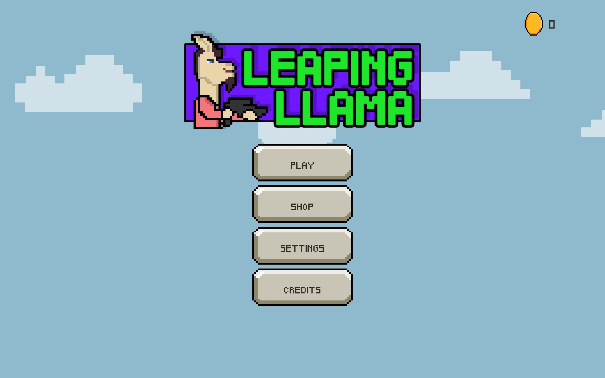

A small video game is a complete exercise in object-oriented design: entities that inherit behaviour, a loop that updates and draws them, collisions, and a state that has to survive between sessions. In 2021 Giovanni and I, under the name Overloaded Llama, wrote our first one as the final project of the Object-Oriented Programming course. Leaping Llama is a 2D endless runner for Android, written in Java with LibGDX: the llama runs to the right on its own, and the player jumps over gaps, ducks under flying aliens, punches or shoots the ones on the ground, and collects coins and ammunition. The [source code](https://github.com/overloadedllama/leapingllama) is public.

The alpha version was published on the Google Play Store and was removed in early 2024: keeping it there would have required a major update of both the game engine, by then outdated, and of the app itself, to comply with the policies Google requires of every app in the store. We planned that maintenance for mid 2025, but it did not happen.

In August 2026 we [rewrote the game from scratch](https://github.com/overloadedllama/leapingllama2) for the web instead, in one night, in JavaScript, using PixiJS v8 and Claude. The remake reuses the original art, read directly from the packed LibGDX atlases, and keeps the original score formula, distance + 30·coins + 20·aliens + 10·ammo. It covers the endless mode only, in three difficulties, and drops the hand-authored levels, Box2D, SQLite and user profiles of the Android version: physics is a small axis-aligned solver and progress is saved in the browser's `localStorage`. The terrain is generated in 50 m chunks of increasing difficulty, under constraints that keep every run possible; for instance, each gap fits within 60% of a full jump at the current speed. It runs in the browser, with keyboard or touch controls, at [leapingllama.vercel.app](https://leapingllama.vercel.app/).
