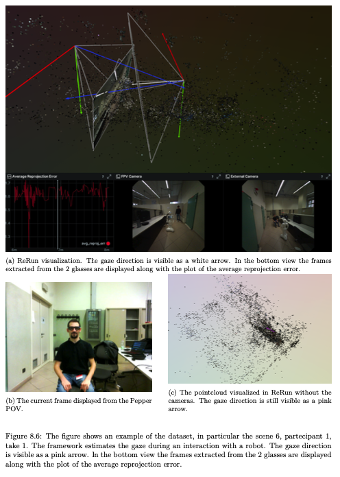

Gaze is one of the main non-verbal channels of human communication: where a person looks reveals what they attend to and whether they intend to engage. A robot that works with people needs this cue, but estimating gaze in dynamic, real-world environments, rather than in the laboratory, is a practical problem that is still not completely solved, and new models need reference data to be validated against. My M.Sc. thesis in Computer Engineering at the University of Modena and Reggio Emilia, supervised by Prof. Roberto Vezzani and defended in October 2024, develops a framework that estimates gaze "in the wild" and labels the 3D position of the point being looked at.

The framework is built around Meta's Project Aria glasses, a research device with two eye-tracking cameras. A VGG network estimates the gaze direction of the wearer from the images of the pupils. The recordings of the different devices are synchronised through timestamps shown as QR codes, frames are extracted, and a Structure from Motion (SfM) reconstruction, computed with HLOC and PyCOLMAP, provides a 3D model of the room together with the pose of every camera in it. The gaze direction is then converted into a 3D gaze point in the reconstructed space, from which it can be reprojected into any other localised view: a second pair of Aria glasses, or the camera of a robot. The pipeline is a sequence of Python scripts, with the results inspected in Rerun.

With the framework I recorded a dataset ([more about it here](/gaze-dataset)) of 10 participants performing common actions while wearing the glasses, with and without a Pepper humanoid robot to interact with, filmed by a second pair of glasses and by the robot itself. It is meant as a potential benchmark and validation tool for new gaze estimation models, especially in human-robot interaction (HRI). The thesis also includes a case study developed in parallel, in which a robot manipulator performs pick-and-place tasks driven by the gaze of a user wearing the glasses. The code is in the [repository](https://github.com/jacksalici/sfm-gaze-framework); the files of the thesis are deposited in the [university archive](https://morethesis.unimore.it/theses/available/etd-09262024-135659/) with restricted access; for the dataset, contact me.

## Thesis structure

- **Part I** profiles the state of the art and the challenges of human-robot interaction, with particular attention to the role of gaze, and reviews the literature together with the methods explored in the preliminary work (Chapter 2).
- **Part II** analyses the hardware: the Pepper robot, a humanoid designed for social interaction (Chapter 3), the Project Aria glasses, which record egocentric views (Chapter 4), and the other devices used in this work and, more generally, in HRI (Chapter 5).
- **Part III** is the core contribution: the methodology and the pipeline of the framework for gaze analysis (Chapters 6 and 7), and the dataset recorded and processed with it, with its implications (Chapter 8).
- **Part IV** presents the case study of the gaze-driven pick-and-place manipulator (Chapter 9), followed by the conclusions and possible future developments (Chapter 10).
