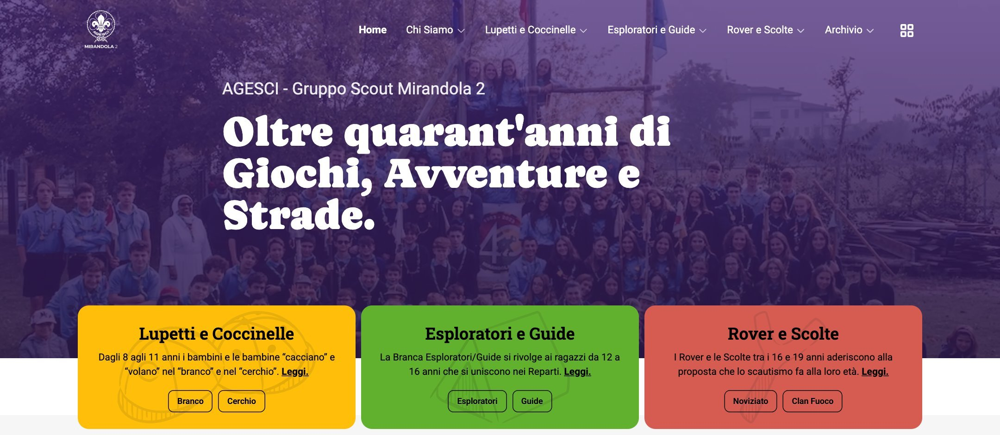

In autumn 2024 I developed the new website of the scout group of my town, where I serve as a scout leader, and in October 2026 I rewrote it on Next.js (see the update below).
A website is essential nowadays, but this project had a few constraints that made it challenging. The first is practical, the others are more technical.

- The budget is close to zero. As a non-profit association, we prefer not to spend money on anything not directly connected to our purpose.
- We wanted something easy to maintain: Markdown files for the content and automatic deployment.
- We wanted a database for our data and other dynamic content. This last point ruled out the "classic" static site generators: with tons of archive images, maintaining them as static files would have been impossible.

## Update (November 2026)

In October 2026 the site moved from Nuxt to Next.js, written in TypeScript with React, Tailwind CSS and DaisyUI. The constraints are the same, but the site now also does things a purely static frontend could not: it has a reserved area for the leaders and works as an installable app.

- **Pages**: the public pages are still static, prebuilt at deploy time. Content is written in MDX, Markdown with a small set of custom components (cards, figures and carousels, staff lists, link lists), so pages can be edited without knowing React. When data are edited from the site, Next.js regenerates only the pages that use them, within seconds and without a new deploy.
- **Database**: the separate backend and Cloudflare D1 are gone. The site reads a SQLite database on Turso's free tier directly, through Drizzle ORM. It holds the data that change over time: staff, totem names, photo and video collections, materials and links, member codes and birthdays.
- **Hosting**: the site runs on Vercel's free plan and the database on Turso, both in Frankfurt, so personal data stay in Europe and the database sits next to the functions that query it.
- **Tabù**: a reserved area where leaders sign in with Google; only the addresses listed in the staff table are allowed in. 
- **App**: the site is a PWA. It can be installed on a phone and keeps the most used pages available offline; the private pages are removed from the device on sign-out.
- **Tools**: a Morse translator that plays messages as sound or with the phone torch, a generator for the scout game "Alce Rossa" with PDF export, a member-code lookup that runs on the server behind a shared token, the upcoming birthdays on the home page, and a page that builds the payment reference for census fees and camps.

Images are handled as before: ImageKit for covers, now through a custom `next/image` loader, and OneDrive (and now also Google Workspace free for non-profits) for the photo archive. Analytics come from Vercel Web Analytics, which uses no cookies.

## The first version (2024)

The first architecture was 100% free to host and maintain, and it had four main parts:
- **Database**: Cloudflare D1, a free SQLite-based database hosted on Cloudflare Workers, whose free tier offered 10 million requests per month, more than enough for our low-traffic website.
- **Middleware**: built with Node.js and Express.
- **Frontend**: built with Nuxt 3, a static website generated at build time that fetched the content from the middleware API. It was hosted on Netlify because our `.it` domain was not supported by other services such as Cloudflare Pages.
- **Images**: ImageKit for the most important images (like the homepage banner), and OneDrive for the rest. The second may raise some eyebrows, but as a non-profit association we already had a Microsoft 365 subscription, so we took advantage of it. With Power Automate, I created a flow that automatically syncs the images uploaded to a specific OneDrive folder to a public folder, making them accessible via a direct link. ImageKit was used for the most important images because it offers image optimization and a CDN, which OneDrive does not.
