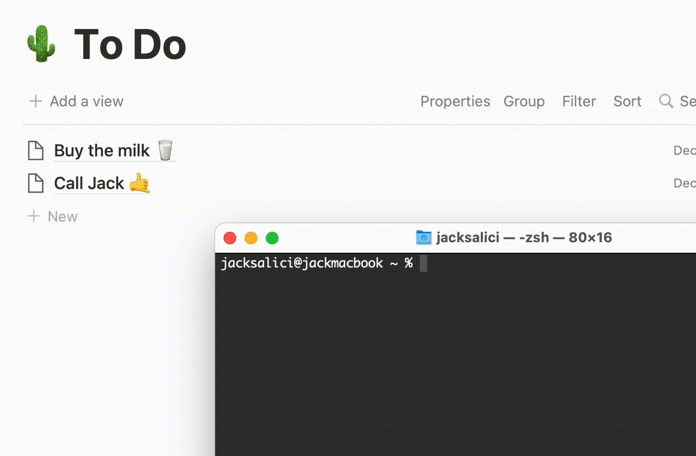

Writing down an idea is only useful if it takes less time than the idea takes to fade, and opening a full workspace application to add one line to a list does not meet that bar. [Notion](https://notion.so) lets you use databases as lists of notes and pages; I have used it for years, but adding a record through its interface was slow enough that I wrote a command-line client in Python for those list databases.



The tool installs a single `list` command that talks to the Notion API through an internal integration token: the database has to be shared with the integration, then token and default database ID are stored once with `list set`. After that, `list` prints the items of the default database as an ASCII table, `list add` creates a page, `list rm` deletes items by index, with ranges and lists such as `3,4,6:10:2`, and `list db` registers further databases under a label and chooses which properties to show and in which order. Properties are read-only, and relations and rollups are not supported.

```sh
uv tool install notion-cli-list-manager
list set --token [token] --id [database-id]
list add "get money"
list
```

 The [GitHub repository](https://github.com/jacksalici/notion-cli-list-manager) has the full command reference, and it collected more stars than I expected.

## Update (November 2026)

Version 1.1 rewrites the codebase and moves it to the current Notion API. The token is now stored in the system keychain instead of a plain-text file, databases with more than 100 pages are listed in full, and `list rm` moves pages to the Notion trash, so they can be restored. Two commands are new: `list edit` opens a page's content as Markdown in nano and updates the page on save, and `list show configs` opens the configuration file. It needs Python 3.11 or later.

