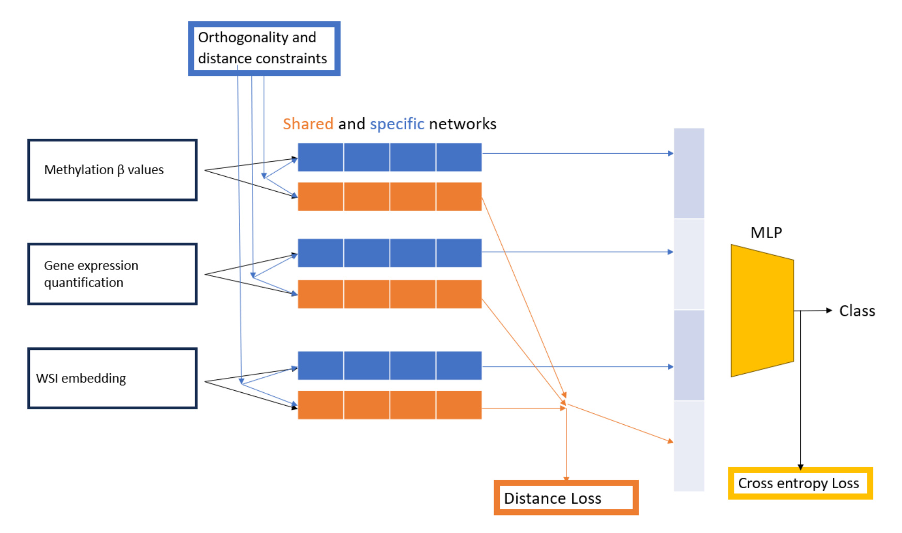

In oncology, overall survival (the time between diagnosis and death) drives the schedule of follow-up examinations and the choice of treatment, and it depends both on the molecular profile of a tumour and on how the affected tissue looks under the microscope. Most survival models use molecular data alone. For the final project of the AI for Bioinformatics course of our master's degree, Davide, Cosimo and I tested whether adding histological whole-slide images (WSI) to multi-omics data improves the prediction for ovarian cancer.

We used the TCGA-OV cohort from the NCI Genomic Data Commons: DNA methylation beta values, gene expression (RNA-Seq, FPKM) and copy number variation, plus the slides, which are about 30000 × 30000 pixels each. Slides are segmented and cut into 1024 × 1024 patches with CLAM, and every patch is encoded into a 512-dimensional vector by PLIP, a CLIP model fine-tuned on pathology images. We explored two architectures. The first is a variational autoencoder with mixed integration, taken from CustOmics and trained with a Cox partial log-likelihood loss; it worked on the omics but we did not carry it on to the images. The second, the one we extended, is a Siamese network in which every modality goes through a shared network, pulled towards the other modalities by a distance loss, and a specific network, kept orthogonal to the shared one; the concatenated outputs feed an MLP that classifies patients as short or long survivors, with a threshold of four years. Our addition is the image branch: the WSI embedding is the concatenation of 10 patch embeddings, either the 10 that a zero-shot PLIP classifier scores highest for "tumor", or 10 drawn at random at every forward pass.

Only 259 of the 600 cases had methylation, gene expression, at least one slide and a known survival time. On these, the best configuration (methylation, gene expression and randomly sampled WSI patches) reached an accuracy of 0.69 in the binary classification, averaged over 20 independent trainings, and images gave a small gain over the omics alone; adding copy number variation as a fourth input lowered the metrics. For reference, the original omics-only Siamese network reports an accuracy of 0.64 on its own ovarian cohort. The model overfits heavily, with a training accuracy as high as 0.95, which we attribute to the small cohort and to the tens of thousands of noisy features. Code and report are linked from this page.
