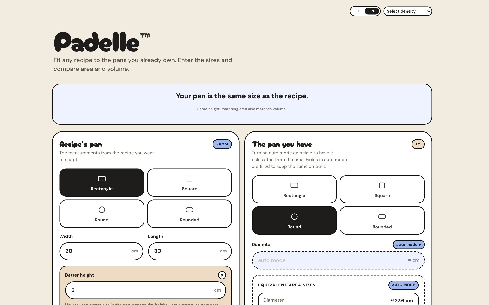

A baking recipe is written for one pan, and the pan in the cupboard is usually a different one. Whether a 20 × 30 cm tray can be replaced by a round tin is a small geometry problem that nobody wants to solve with floury hands.

Padelle (Italian for "pans") compares the pan of the recipe with the pan you own. Each pan is a rectangle, a square, a circle or a rectangle with rounded corners, and the app computes its base area *A*; for the rounded rectangle with corner radius *r* this is *A* = *w*·*l* − (4 − π)·*r*². The result is the ratio between the two areas, which is the factor by which the recipe has to be scaled to keep the same batter height:

$$
k = \frac{A_\text{yours}}{A_\text{recipe}}
$$

When a batter height is given, the app also reports the capacity, *V* = *A*·*h*, the ratio between the volumes and the difference in millilitres. A field left in auto mode is solved for instead of entered: for a round pan the diameter with the same area is *d* = 2·√(*A*/π), so a 20 × 30 cm tray corresponds to a 27.6 cm tin, and a button computes the batter height that keeps the same volume. Choosing one of eight preset densities, from oil (0.92 g/ml) to honey (1.42 g/ml), converts the volumes into weight. The interface is in Italian and English, and I built it as a Next.js app.
