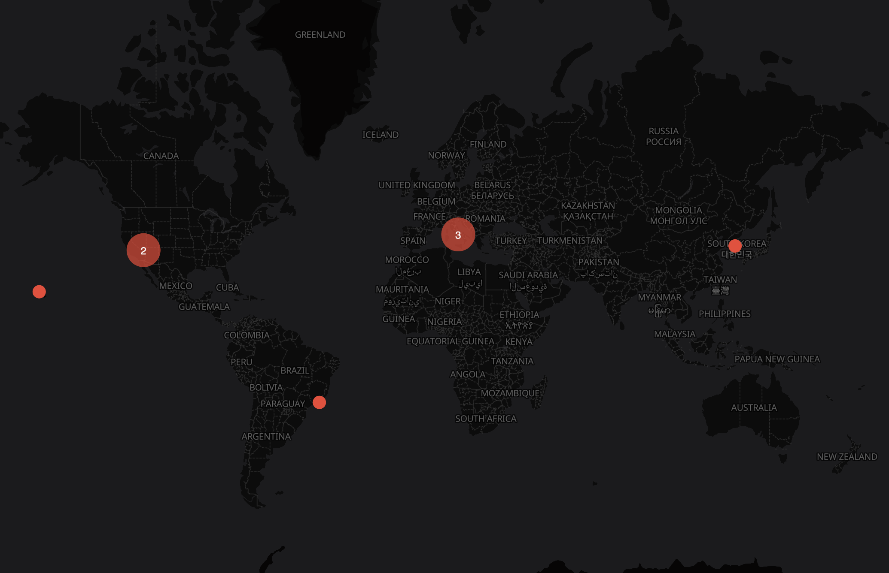

A list of publications says what was published and when, but not where: every conference paper is also a trip to the city where it was presented. This page puts the venues of my papers on a world map, one pin per paper.

The map is generated from the same content collection as the publication list. Each paper entry can carry a `coordinates` field (longitude and latitude of the venue) in its frontmatter; at build time the Astro page keeps the papers that have one and serialises title, venue and coordinates as JSON into the page. In the browser, a script turns them into a GeoJSON source and draws it with MapLibre GL on OpenFreeMap vector tiles. Points closer than 50 pixels are merged into a cluster showing the count; clicking a cluster zooms in until it splits, and clicking a pin opens a popup with every paper that shares those coordinates, each linked to its page. At the moment the nine papers on the site are spread over six cities.
