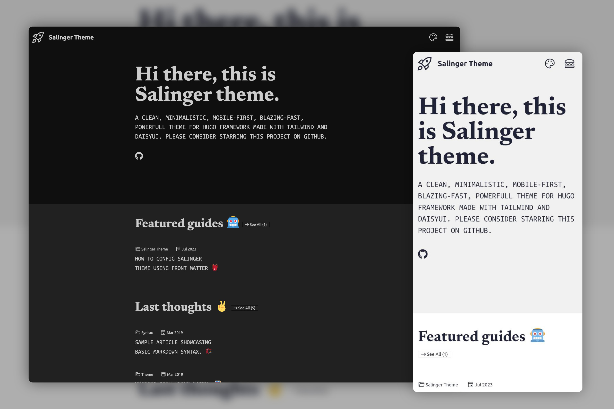

A static site generator turns Markdown files into a website, and the theme decides everything a visitor actually sees. Salinger is a minimal, mobile-first theme for the [Hugo framework](https://gohugo.io) that I wrote for an earlier version of this website and then released on its own.

The second major version, from July 2023, is a complete rewrite on Tailwind CSS and DaisyUI. It has light, dark and automatic colour modes, a hamburger menu with a custom icon, Twemoji rendering of emoji, per-page control over which metadata are shown, Google Analytics and SEO tags; the README reports a 100% score on PageSpeed. The theme is added to a Hugo project as a git submodule and configured from `hugo.toml`, and it was featured at HugoConf 2023.

The name comes from the light-mode home page, whose design was inspired by [the cover of the 1961 Einaudi edition](https://duckduckgo.com/?q=il+giovane+holden+by+j.d.+salinger+einaudi+1961&t=h_&ia=images&iax=images&iaf=color%3AWhite) of _The Catcher in the Rye_ by J.D. Salinger. Usage instructions are in the [GitHub repository](https://github.com/jacksalici/salinger-theme) and its wiki, and the [demo site](https://salinger-hugo-theme.netlify.app) shows the theme running.

## Features

The feature that I love of this theme are:

- TailwindCSS and DaisyUI framework
- Responsive and mobile-first
- Google Analytics
- Custom visibility of meta
- Dark, Auto and Light Mode
- Hamburger Menu with custom icon
- Tweemoji Emoji support
- SEO support (100% score on PageSpeed)
- Google Symbols and Font Awesome