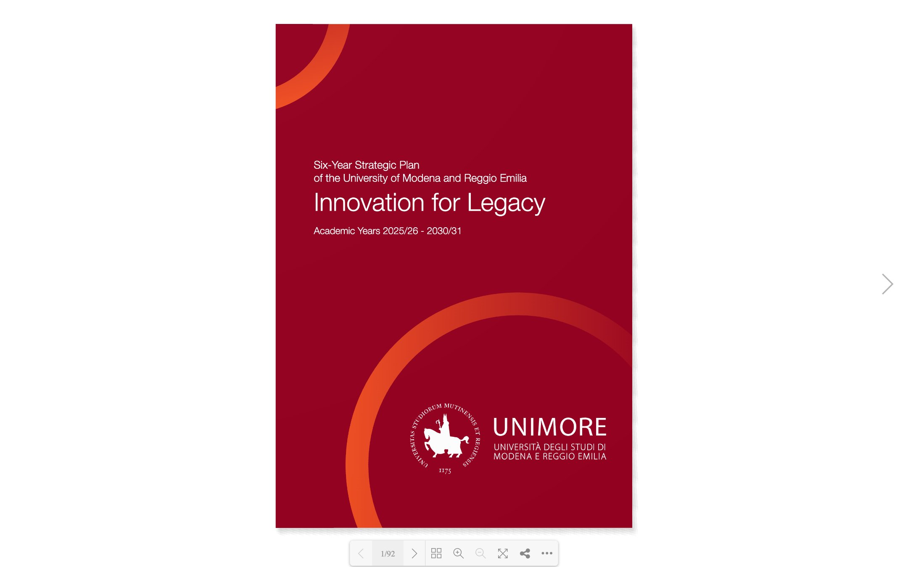

A university's strategic plan is the document in which its governance states what the institution intends to do over the coming years, and it is read by people who will not go through it page by page, so its layout decides how much of it gets across. "Innovation for Legacy" is the Six-Year Strategic Plan of the University of Modena and Reggio Emilia for the academic years 2025/26 to 2030/31, written by the Rector together with the governance bodies and designed by me.

I laid out the 92 pages with Affinity by Canva. The plan sets out the university's mission, vision and guiding principles, then the strategic areas with their objectives, actions and indicators, the positioning targets and the monitoring of the plan. It was approved by the Academic Senate on 19 February 2026 and by the Board of Directors on 3 March 2026, and it is published in Italian and in English on the university website, both as a PDF and in a page-turning viewer.
