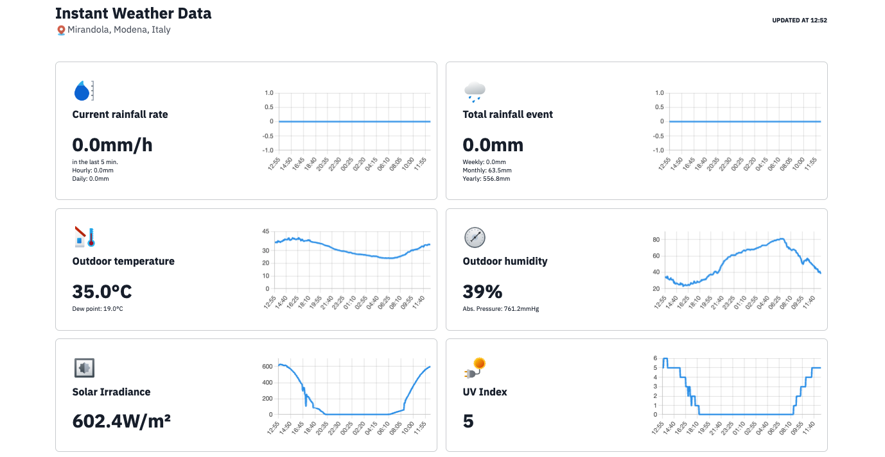

A home weather station measures continuously, but its data usually stay inside the manufacturer's app. I have an Ecowitt station in Mirandola, in the province of Modena, and I wanted its readings on a public page of my own.

The project has two parts. The front-end is a Vue single-page app styled with Tailwind and DaisyUI, with Chart.js for the plots: each card shows the current value of one quantity next to its history. The middleware is a Cloudflare Worker that sits between the page and the Ecowitt API. It exists because the API requires a secret key that cannot be shipped to the browser: the Worker stores it as a secret, adds it to the request and returns the JSON. It exposes two endpoints, one for the instantaneous readings and one for the history between two dates, which the dashboard queries for the last 24 hours at 5-minute resolution.
