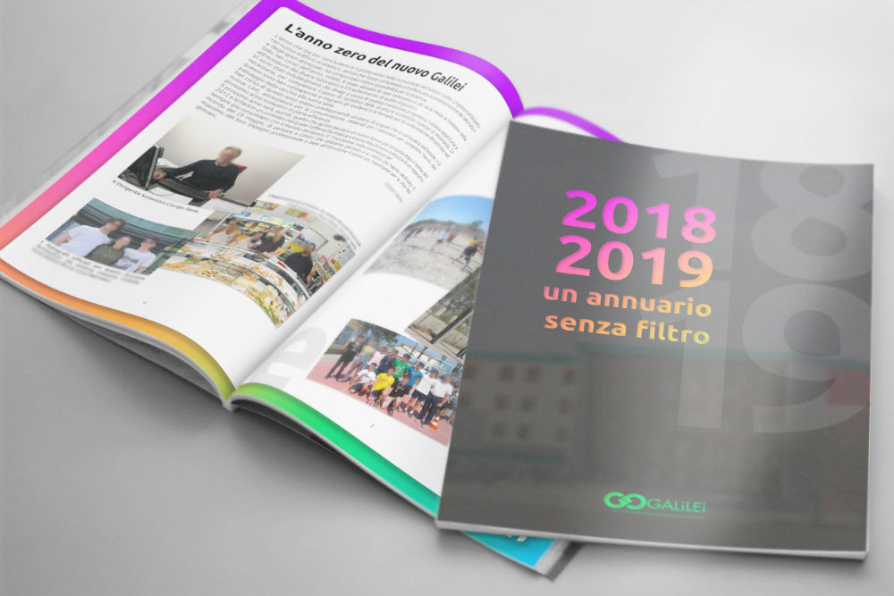

A school yearbook is a small editorial project: texts and photographs from many hands have to fit a single template. In my last year of high school I took care of ours, the 2018/2019 edition, and designed all of its 76 pages. The picture shows a first draft of the final template.

