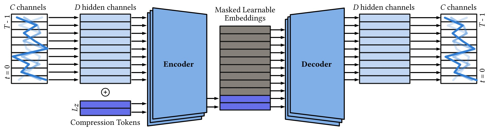

**Abstract:** We present a predictive maintenance approach for industrial production lines based on multivariate segment-wise time-series analysis. To address the high cost of collecting anomalous samples, we propose a novelty detection framework in which a transformer autoencoder is trained in a semi-supervised fashion exclusively on nominal sequences, and anomaly scores are derived from reconstruction error at test time. We introduce a set of learnable “compression tokens” into the transformer encoder; these tokens serve as the bottleneck from which the decoder reconstructs the input. We compare this model against an MLP-based autoencoder baseline; the results show that the novelty-detection model remains strong, with near-perfect performance under time-aware and device-aware validation, which are the conditions that most faithfully simulate deployment.

---

## A closer look

Unplanned downtime is one of the largest avoidable costs of a production line, and predictive maintenance tries to prevent it by recognising the early signature of a fault in sensor data. The obstacle is supervision: failures are rare, expensive to label and open-ended, so a classifier trained on a library of known faults generalises poorly to the ones it has not seen. We therefore treat the problem as novelty detection: the model is trained only on nominal acquisitions and flags whatever it cannot explain.

*Figure 1 — The segment-wise autoencoder. Compression tokens gather the content of the whole sequence through self-attention; the decoder rebuilds the input from them alone, and the reconstruction error is the anomaly score.*

Each acquisition $X \in \mathbb{R}^{T \times C}$ is a complete production cycle, and we keep it whole instead of cutting it into sliding windows, because the fault signature is spread over the entire segment. The sequence is projected to dimension $D$ and $L_z$ learnable *compression tokens* $z$ are appended to it, $X_\text{aug} = [\hat{X}; z] \in \mathbb{R}^{(T + L_z) \times D}$. After the transformer encoder, the decoder receives only those tokens, next to $T$ copies of a shared mask token, and has to reconstruct the full sequence $X'$. The tokens are thus an information bottleneck, and the training loss doubles as the anomaly score at test time:

$$
\mathcal{L}_\text{MSE} = \frac{1}{T \cdot C} \sum_{t=1}^{T} \sum_{c=1}^{C} \left( X_{t,c} - X'_{t,c} \right)^2
$$

Before entering the model, acquisitions are aligned in time by cross-correlation against a reference sequence, smoothed with a Gaussian kernel and z-scored with statistics computed on nominal training data only.

We evaluate on a distribution-unit line driven by six motors, one of them anomalous, with data provided by SEW-Eurodrive: 1,288 series of 2,234 time steps and 10 channels each. With $D = 64$ and $L_z = 2$ the model reaches 99.75% AUPRC when trained on earlier acquisitions and validated on later ones, and 99.47% on devices held out from training, the two splits closest to deployment. An MLP autoencoder on the flattened segment scores about the same (99.29% and 99.36%) but needs 70.8M parameters against our 489K, less than 0.7% of its size.
