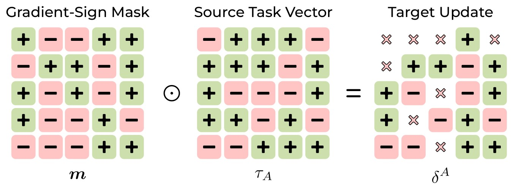

**Abstract:** When a new release of a foundation model is published, practitioners typically need to repeat full fine-tuning, even if the same task has already been solved in the previous version. A promising alternative is to reuse the parameter changes (i.e., task vectors) that capture how a model adapts to a specific task. However, they often fail to transfer across different pre-trained models due to their misaligned parameter space. In this work, we show that the key to successful transfer lies in the sign structure of the gradients of the new model. Based on this insight, we propose GradFix, a novel method that approximates the ideal gradient sign structure and leverages it to transfer knowledge using only a handful of labeled samples. Notably, this requires no additional fine-tuning: the adaptation is achieved by computing a few gradients at the target model and masking the source task vector accordingly. This yields an update that is locally aligned with the target loss landscape, effectively rebasing the task vector onto the new pre-training. We provide a theoretical guarantee that our method ensures first-order descent. Empirically, we demonstrate significant performance gains on vision and language benchmarks, consistently outperforming naive task vector addition and few-shot fine-tuning.

---

## A closer look

Foundation models are released in successive versions, and every new checkpoint invalidates the fine-tuning done on the previous one: the same task has to be learned again. The change that fine-tuning makes to the weights, the *task vector* $\tau = \theta_\text{ft} - \theta_0$, is the natural thing to reuse, but adding a task vector obtained on one pre-training to a model with a different one does almost nothing, because the two parameter spaces are not aligned.

*Figure 1 — The masking procedure. The gradient-sign mask $m$ removes from the source task vector $\tau_A$ the directions that would hurt the target model and keeps the ones aligned with it.*

GradFix keeps only the coordinates of the source task vector $\tau_A$ whose sign agrees with the descent direction of the target model $\theta_B$. With $g = \nabla_\theta \mathcal{L}(\theta_B)$ the gradient of the task loss at the target, the mask and the transported model are

$$
m_i = \mathbb{1}\!\left\{ \operatorname{sign}(\tau_{A,i}) = \operatorname{sign}(-g_i) \right\}, \qquad \theta_B^\text{trans} = \theta_B + \alpha \, (m \odot \tau_A).
$$

Each retained coordinate contributes a non-positive term to the inner product between the gradient and the update $\delta_A = \alpha\,(m \odot \tau_A)$,

$$
g^\top \delta_A = -\alpha \sum_i m_i \, |g_i| \, |\tau_{A,i}| \le 0,
$$

so to first order the transported update cannot increase the target loss. Nothing is trained on the target. We only compute gradients on a handful of labelled samples and aggregate their signs by majority vote, an estimate whose probability of error decays exponentially with the number of samples.

Between two CLIP ViT-B/16 checkpoints (pre-trained on DataComp-XL and on LAION-2B), with one labelled example per class, GradFix reaches 71.07% accuracy on SVHN, where naive addition of the task vector stays at 50.84%, next to the 50.58% of the zero-shot model, and few-shot fine-tuning on the same examples gets 61.32%. From T5 v1.1 to FLAN-T5, with 50 examples per class, the average over five language-inference tasks is 58.48%, against 42.12% for naive addition and 42.33% for few-shot fine-tuning. Transported task vectors also improve multi-task and multi-source model merging.
