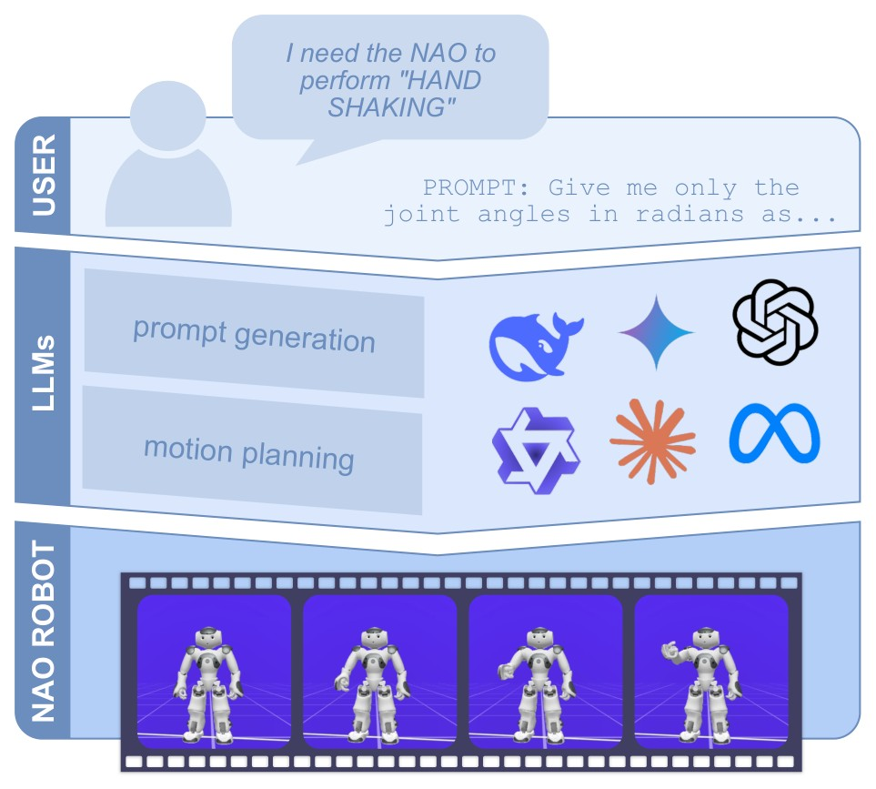

**Abstract:** In this study, we demonstrate the capabilities of state-of-the-art Large Language Models (LLMs) in teaching social robots to perform specific actions within a 3D environment. Specifically, we introduce the use of LLMs to generate sequences of 3D joint angles - in both zero-shot and one-shot prompting - that a humanoid robot must follow to perform a given action. This work is driven by the growing demand for intuitive interactions with social robots: indeed, LLMs could empower non-expert users to operate and benefit from robotic systems effectively. Additionally, this method leverages the possibility to generate synthetic data without effort, enabling privacy-focused use cases. To evaluate the output quality of seven different LLMs, we conducted a blind user study to compare the pose sequences. Participants were shown videos of the well-known NAO robot performing the generated actions and were asked to identify the intended action and choose the best match with the original instruction from a collection of candidates created by different LLMs. The results highlight that the majority of LLMs are indeed capable of planning correct and complete recognizable actions, showing a novel perspective of how AI can be applied to social robotics.

---

## A closer look

Programming the movements of a humanoid robot requires knowing its joints, their limits and how to sequence them in time, which keeps out the non-expert users that social robots are built for. We test whether a large language model can do the planning directly: given only the name of an action, write the sequence of 3D joint angles the robot has to follow.

*Figure 1 — The use case: the user names an action, the LLM returns the joint angles, and the NAO robot plays them as a motion.*

For each of 15 actions inspired by the NTU RGB-D classes (clapping, hand waving, kicking, sitting down and so on), a model returns a matrix $J_a \in \mathbb{R}^{T_a \times N}$ of joint angles $\sigma_i^t$ in radians, deciding by itself the number of time steps $T_a$ and which of the 25 degrees of freedom of the NAO robot to move. We compare seven LLMs (ChatGPT-4o, Claude 3.7 Sonnet, DeepSeek-V3, Gemini 2.0 Flash, LLaMA 3.3 70B, LLaMA 4 Maverick and Qwen 2.5 Max) under two prompts,

$$
J_a = \lambda_0(a) \quad \text{(zero-shot)}, \qquad J_a = \lambda_1(a, B, J, J_L) \quad \text{(one-shot)},
$$

the first with only the robot name and the action $a$, the second adding the base pose $B$, the joint names $J$ and the joint limits $J_L$. The sequences are executed in simulation, recorded, and judged in a blind user study with more than 50 participants and over 2,000 answers.

Shown a video and four action names, participants pick the intended action 64.2% of the time for zero-shot sequences and 66.6% for one-shot ones. What the extra information in the prompt buys is mostly robustness: joint angles outside the limits disappear, and the robot gets stuck or falls less often. When asked which model renders an action best, participants choose Claude 3.7 Sonnet most often (27.3% of the zero-shot choices and 22.6% of the one-shot ones, among seven models). The comparison with motions designed by an expert is more sobering: only in 44.7% of the answers was the generated motion judged to be the same action as the expert's, 60.3% for the best model. LLMs can plan recognisable motions for a well-documented robot, but not yet at the quality of hand-crafted ones.
