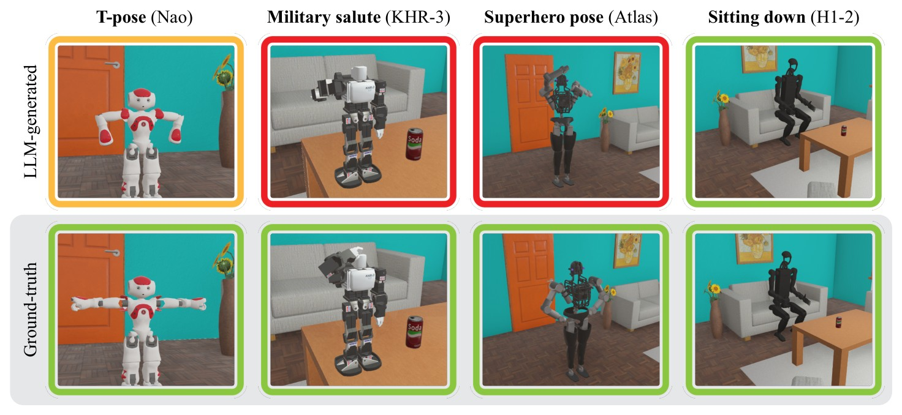

**Abstract:** Humanoid robots are increasingly being integrated into diverse scenarios, such as healthcare facilities, social settings, and workplaces. As the need for intuitive control by non-expert users grows, many studies have explored the use of Artificial Intelligence to enable communication and control. However, these approaches are often tailored to specific robots due to the absence of standardized conventions and notation. This study addresses the challenges posed by these inconsistencies and investigates their impact on the ability of Large Language Models (LLMs) to generate accurate 3D robot poses, even when detailed robot specifications are provided as input.

---

## A closer look

Humanoid robots are entering healthcare facilities, schools and workplaces, where the people who operate them are not roboticists and natural language would be the obvious interface. Large language models can already turn a request into joint angles, but the published evidence almost always concerns one model and one robot, while robots differ in kinematic structure, joint names and axis conventions. We measure how much that diversity matters.

*Figure 1 — LLM-generated poses (top) against the ground truth (bottom) for the four robots. The frame colour is our qualitative judgement: green achieved, yellow partially achieved, red not achieved.*

Four LLMs (ChatGPT-4o, Gemini 2.5 Flash, Claude 3.7 Sonnet and DeepSeek-V3) are asked for the joint angles, in radians, of four poses (T-pose, military salute, superhero pose, sitting down) on four robots (Nao, KHR-3, Atlas and H1-2), and the answers are executed in the Webots simulator. The robot name alone was enough to obtain the right joint names only for Nao, so the prompt carries the full URDF file, the default pose and the reference-frame convention. Three experts judge each pose, and we score it against a ground truth defined in the simulator with the mean per-joint angular error, computed over the $J_i$ joints that the ground truth moves in each of the $N$ poses:

$$
\text{MPJAE} = \frac{1}{N} \sum_{i=1}^{N} \frac{1}{J_i} \sum_{j=1}^{J_i} \left| \theta_{i,j}^\text{LLM} - \theta_{i,j}^\text{GT} \right|
$$

The error depends on the robot much more than on the model: on Nao it ranges from 0.32 to 0.65 rad across the four LLMs, on KHR-3 from 1.30 to 2.15 rad. Claude 3.7 Sonnet has the lowest error on three robots out of four. We attribute the advantage of Nao to how well documented it is, and to joint names that say what they do; in KHR-3, by contrast, the joint labelled `RShoulder` drives the adduction of the upper arm and `RArm` its abduction. It argues for a shared naming and semantic convention across humanoid platforms.
