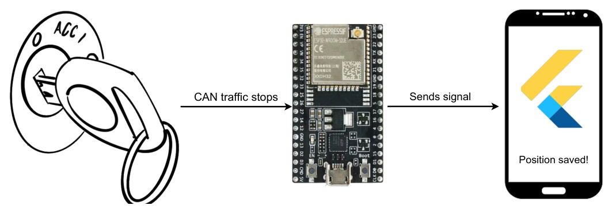

**Abstract:** Efficient energy provisioning is a fundamental requirement for modern transportation systems, making refueling path optimization a critical challenge. Existing solutions often focus either on inter-vehicle communication or intravehicle monitoring, leveraging Intelligent Transportation Systems, Digital Twins, and Software-Defined Internet of Vehicles with Cloud/Fog/Edge infrastructures. However, integrated frameworks that adapt dynamically to driver mobility patterns are still underdeveloped. Building on our previous PIENO framework, we present RI-PIENO (Revised and Improved Petrolfilling Itinerary Estimation aNd Optimization), a system that combines intra-vehicle sensor data with external geospatial and fuel price information, processed via IoT-enabled Cloud/Fog services. RI-PIENO models refueling as a dynamic, time-evolving directed acyclic graph that reflects both habitual daily trips and real-time vehicular inputs, transforming the system from a static recommendation tool into a continuously adaptive decision engine. We validate RI-PIENO in a daily-commute use case through realistic multi-driver, multi-week simulations, showing that it achieves significant cost savings and more efficient routing compared to previous approaches. The framework is designed to leverage emerging roadside infrastructure and V2X communication, supporting scalable deployment within next-generation IoT and vehicular networking ecosystems.

---

## A closer look

Every vehicle has to stop for energy, and choosing where and when to do it trades money against time. Our earlier framework, PIENO, read the fuel level from the CAN bus and combined it with station locations and forecast prices to recommend the next refueling stop, but it treated each recommendation as a one-off decision and ignored where the driver was going anyway. RI-PIENO adds the missing piece: a model of the driver's own mobility.

*Figure 1 — When the engine is switched off the CAN traffic stops; the ESP32 notices it and signals the app, which saves the position as a stop.*

Stops are detected for free, because the CAN bus falls silent when the car is turned off; they are clustered within 100 m, and the places visited more than twice a week become points of interest. Ordering them in time gives, for each day of the week, a directed graph of the habitual trips, the *Daily Trip Graph*. A Random Forest regressor forecasts the weekly mileage, from which we estimate the extra distance $\delta$ driven outside those habitual routes. On the day with the cheapest forecast price, every station within 2 km of the habitual route is a candidate $k$, with a fuel cost and a time cost

$$
C_k = \left( f_\text{full} - f_0 + r \cdot \hat{l}_k \right) c_k, \qquad T_k = t_k + \Delta,
$$

where $f_\text{full}$ is the tank capacity, $f_0$ the current fuel level, $r$ the consumption rate, $\hat{l}_k$ and $t_k$ the distance and driving time of the route through the station, $c_k$ its price and $\Delta$ the time spent refueling. The recommended stop minimises

$$
L_k = \begin{cases} K_1 \cdot C_k + K_2 \cdot T_k & \text{if } r \cdot \hat{l}_k \le f_0 \\ \infty & \text{otherwise,} \end{cases}
$$

so stations out of reach are excluded, and the constants $K_1$ and $K_2$ set how much the driver cares about cost and about time.

We replay 15 recordings from 3 users and simulate what each strategy would have advised. In the balanced mode ($K_1 = K_2 = 1$) a stop costs €43.01 ± 2.13 and takes 4.98 ± 0.80 minutes, against €43.24 and 7.10 minutes for PIENO and €44.53 and 6.61 minutes for stopping at the nearest station: the gain is mostly time, about two minutes per stop, because the suggested station lies on a route the driver takes anyway. Setting $K_2 = 0$ lowers the cost to €42.64 at 7.65 minutes; setting $K_1 = 0$ lowers the time to 4.85 minutes at €44.38. The mileage forecast, tested on 45 vehicles of the public VED dataset, is the weakest component: with eight weeks of history the weekly error is still 34.2% ± 21.3%, which is why RI-PIENO uses it only for drivers whose validation error is below a threshold.
