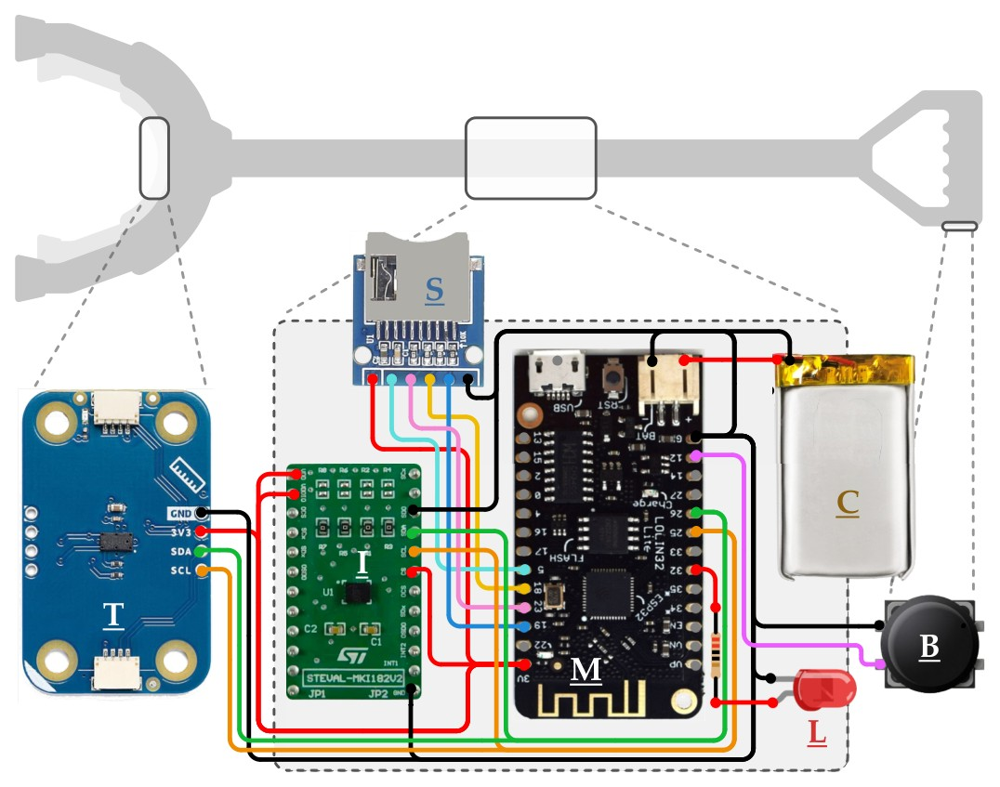

**Abstract:** Wrist-worn wearables are the dominant paradigm for step counting, but their performance degrades noticeably when used by people with motor impairments. We instrument a standard cane with a low-cost sensing framework to address this and, at the same time, to lay the foundation for a self-supervised gait-quality assessment in which a convolutional autoencoder trained only on normal walking uses reconstruction error as an anomaly score. A downward-facing time-of-flight sensor measures the distance of the cane tip from the ground and provides the reference against which step counting is validated, reaching 92.9% accuracy, while on the same recordings the anomaly detector reaches 98.7% AUPRC under session-level cross-validation, also ordering the types of gait problems by how strongly they deform the signal.

---

## Why a cane

Step count and gait quality are established indicators of health, autonomy and fall risk, yet the trackers that measure them are calibrated on the regular gait of healthy people. This work started from a personal observation: my smartwatch has never counted my steps reliably. The device is not faulty. I walk with a cane, and wrist-worn trackers lose accuracy exactly when a walking aid comes into play. The literature reports the same pattern, and the degradation is not limited to people with motor impairments: even healthy participants lose accurate step counts as soon as they are given an aid.

Rather than trying to correct a wrist signal that does not reflect the gait, we moved the sensors to the cane itself: every contact of the cane with the ground produces a distinct acceleration transient that can be analysed.

## The device

*Figure 1 — The smart cane. A 3D-printed enclosure on the shaft holds the microcontroller (M), the IMU (I), the microSD shield (S), the status LED (L) and the LiPo cell (C); the time-of-flight sensor (T) sits under the quad base, and the button (B) on the handle starts, stops and annotates a session.*

Together with Roberto Vezzani at AImageLab, I built an instrumented cane that costs about €50 in off-the-shelf parts and adds less than 80 g to a commercial quad cane. Around an ESP32 board, it carries:

- a six-axis **IMU**, which captures the motion of the cane during each stride;
- a downward-facing **time-of-flight (ToF) sensor**, which measures the distance of the cane tip from the ground and serves as the reference for validating step counts;
- a **button on the handle**, used to label sessions while walking, so that annotation happens at recording time and no video has to be synchronised afterwards.

## Counting steps

Steps are counted from the IMU alone, as peaks of the deviation of the acceleration magnitude from gravity, $|a| - 1\,\text{g}$, that satisfy three conditions: a height above the adaptive threshold

$$
\max(\mu + 3.2\,\sigma,\; 0.30\,\text{g}),
$$

a minimum prominence, and a refractory period of 1.15 s from the previous step. The ToF signal is used only as the independent reference, so that the counter can run on a cheaper cane without the downward-facing sensor. On my own recordings (29 sessions, 18 of normal and 11 of abnormal walking), the cane counts steps with 92.9% ± 5.6% accuracy under leave-one-session-out evaluation.

## From quantity to quality

The second question we addressed is whether the cane can say something about *how* a person walks, not only *how much*. We cast it as anomaly detection: a small 1-D convolutional autoencoder, of about 34,000 parameters, is trained exclusively on 6 s windows of normal walking, and a window is flagged when its reconstruction error exceeds the 95th percentile of the errors on normal validation data. On the same recordings, it flags abnormal gait with 98.7% AUPRC and 92.8% $F_1$ under session-level cross-validation. Removing the ToF channel lowers AUPRC to 93.2% and recall from 95.3% to 74.9%: the channel helps but is not required.

Without access to any class labels, the score also orders the types of gait problems by how strongly they distort the signal: unsteadiness and anomalous long steps exceed the threshold by an order of magnitude, tremors and falls by about three times, and short, irregular steps, where each step still looks normal in isolation, by only 1.5 times. The data come from a single subject, so these results are preliminary.

## Open resources

Hardware design, firmware, code and data are openly available at [cane.jacksalici.com](https://cane.jacksalici.com).
